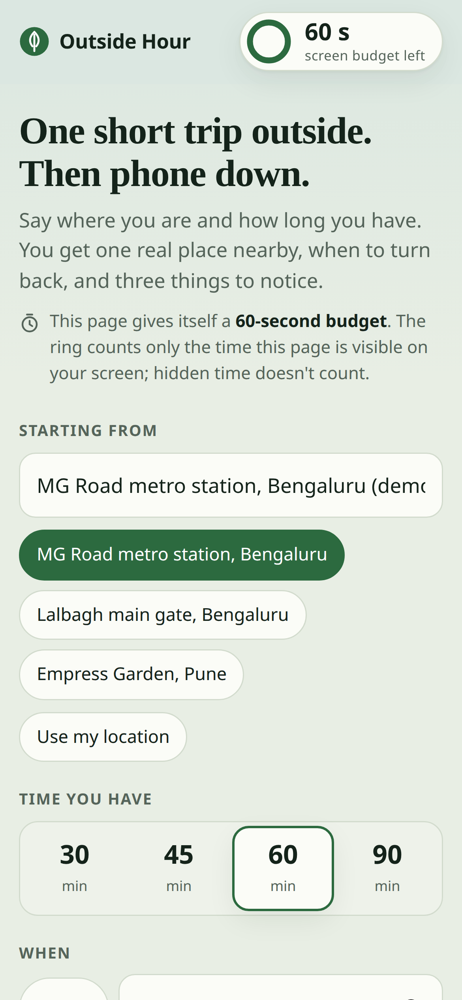
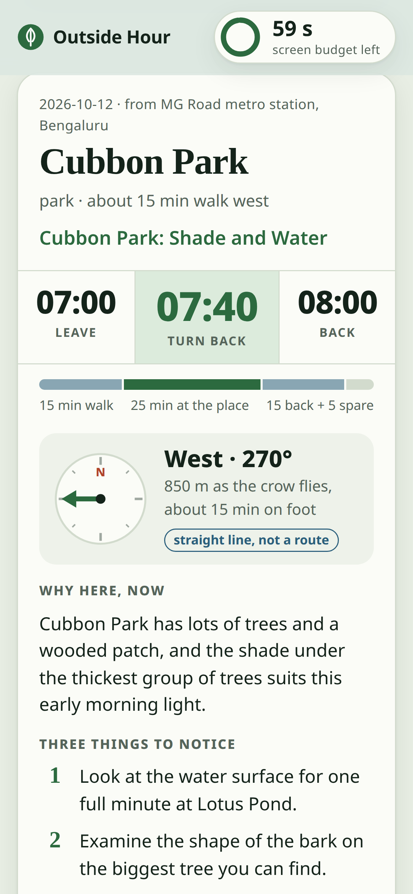
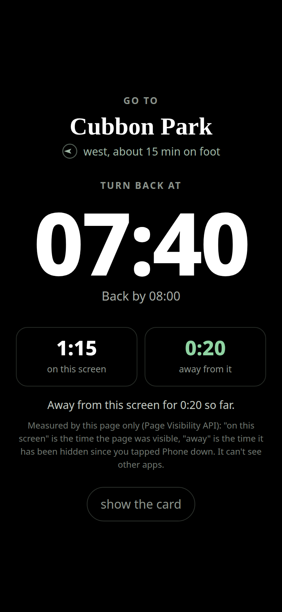
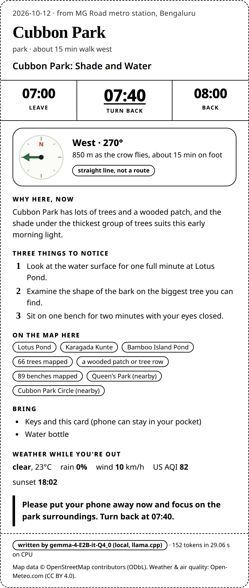
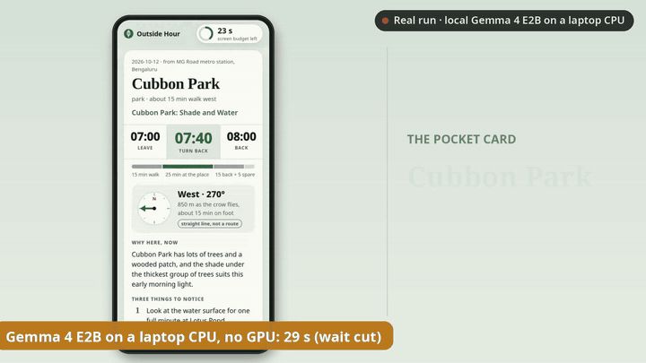

# Outside Hour

**A pocket card for one short trip outside, from a local Gemma model, on a page that gives itself 60 seconds of
your attention.**

Outside Hour looks up real parks, lakes, gardens and viewpoints near you on OpenStreetMap, and what is mapped
inside them (named ponds, trees, benches, drinking-water taps). It checks the weather, sunset and air quality on
Open-Meteo, and asks **Gemma 4 E2B, an open-weight model running on your own CPU**, to pick one place and write a
short pocket card: where to go, when to turn back, three things to notice there, and what to bring. Then it gets
out of the way: a black "phone down" screen, a printable card, and a calendar alarm for the turn-back time.

Built for the DEV × Hacktoberfest 2026 Open-Source AI Challenge, Week 1: "Touch Grass".

| Plan | Pocket card | Phone down | Printed card |
|---|---|---|---|
|  |  |  |  |

Screenshots are from one real run with the local model at phone size (390×844 CSS px): MG Road metro station in
Bengaluru as a demo start, 60 minutes, 07:00 the next morning. The plan Gemma wrote is saved as
[`demo/shots-v2/plan.json`](demo/shots-v2/plan.json). The phone-down screen is from the recording of that run: its
"on this screen" time includes the model wait, and the 20 s "away" is a **simulated** phone lock (headless
browsers never hide a page, so `scripts/record_demo.py` tells the page it is hidden, as a locked phone would).

**Demo video:** [YouTube](https://youtu.be/Tsh3luZPPXA) · [`demo/outside-hour-demo-v2.mp4`](demo/outside-hour-demo-v2.mp4) (81 s, 1920×1080, English
voiceover). It is the real phone-size run above, framed and zoomed: the 29 s model wait is cut and labelled, the
20 s "away" part is shown at 4× speed and labelled as a simulated lock, and a second real run (Lalbagh, 45 min,
17:30) is shown for a few seconds. The voice is Kokoro (local TTS) and the music was synthesised for the video.
The uncut phone recordings are not in the repository (they are large); the cut, held frames and 4× part are labelled on screen.



The earlier desktop demo: [`demo/outside-hour-demo.mp4`](demo/outside-hour-demo.mp4) (51 s, silent, captioned,
the model wait cut and labelled; uncut: [`demo/outside-hour-demo-realtime.mp4`](demo/outside-hour-demo-realtime.mp4)).

## The 60-second budget

The ring in the corner is the main idea. The page counts how long it has been **visible on your screen** and gives
itself 60 seconds. At 40 seconds the ring turns amber and the page starts to dim a little; at 60 it is red, the
page is dimmer (never more than 45 %, so it stays usable) and a note suggests "Phone down". The phone-down screen
shows your turn-back time in huge type, plus two numbers: time **on this screen** and time **away from it**.

It is honest about what a web page can know. It uses the browser's Page Visibility API: time counts only while
the page is visible, and "away" is the time the page has been hidden since you tapped Phone down. It cannot see
other apps, so it is not your phone's screen time. The logic is in `outside_hour/static/attention.js` and is
tested (`tests/test_attention_js.py`, runs with Node if installed).

The model wait (about 30 s on my laptop) counts too, because the page is on screen. You can look away: hidden time
doesn't count. The best use is the evening before: plan tomorrow's 07:00 walk tonight, then just go.

## What it does

1. **You give:** a starting point (place name, your browser location, or a demo start), 30–90 minutes, now or later
   (for example "tomorrow 07:00").
2. **It fetches open data** (no API keys): named parks, gardens, water, viewpoints and paths within walking range,
   plus a second, optional query for what is mapped inside them: unnamed ponds, individual trees, benches, taps,
   toilets, playgrounds (Overpass API). Then the hourly forecast, sunrise, sunset and US AQI for exactly your time
   window (Open-Meteo).
3. **Code does the maths:** walking time (4.5 km/h × 1.3 detour factor), time at the place, turn-back time, a
   sunset cut-off, the light ("early morning", "before sunset", "after dark"), after-dark and thunder/AQI warnings,
   the bring list, and the **direction**: a compass bearing in degrees and the straight-line distance to the
   nearest edge of the place. The card draws this as an SVG arrow labelled "straight line, not a route". No map
   tiles, no third-party map service.
4. **Gemma chooses and phrases:** it gets the 5 best candidates as JSON, each with its walking time, direction,
   named ponds inside it, what else is mapped there (no counts, so it doesn't quote survey numbers) and a few
   "notice" ideas built from those features and the light. It returns one `place_id` plus a headline, a "why",
   three things to notice and a phone-down line. The prompt asks it to be specific to the place and never to
   write filler like "a pleasant spot".
5. **A checker guards the output** (`outside_hour/validate.py`). The draft is rejected if it names a place that is
   not in the fetched map data, talks up a different candidate, uses a number or clock time that is not in the
   facts, mentions water or a view the map data doesn't support, uses stock filler ("offers a pleasant spot",
   "enjoy nature"), looks cut off, or contains stray non-English characters. One retry, then a plain template. The
   card always says who wrote it ("written by gemma-4-E2B-it-Q4_0 (local, llama.cpp)" or "plain template").
6. **You leave:** "Phone down" shows the place, the direction, the turn-back time and the two meters. "Print pocket
   card" prints an A6-wide card. "Turn-back alarm (.ics)" adds a calendar event with an alarm, so your phone's own
   clock reminds you and the app doesn't need to stay open.

## Why local and open

- **Free to run and no account:** OpenStreetMap and Open-Meteo need no keys; the model runs in llama.cpp on a laptop.
- **Your location stays with you:** the model sees your coordinates only on your machine. The only network calls
  are the open-data lookups, and they are cached.
- **Works with a bad signal:** once an area is cached, `--offline` plans with no network at all (weather may be
  stale; the card says so).
- **Open weights let me constrain it:** I can run Gemma with a JSON-schema grammar so `place_id` can *only* be one
  of the places I fetched, and turn off its "thinking" mode to make it fast enough on a CPU.

## Measured on my laptop

Intel Core i5-1035G1 (4 cores / 8 threads, no GPU), 10 GB RAM, WSL2. Model file: `gemma-4-E2B-it-Q4_0.gguf`,
2.84 GB. Numbers from `scripts/bench.py`: 10 different plans (2 cities, 3 start points, 30–90 min, morning to
evening) on cached map data. The current version (place-specific prompt) is in `docs/bench-results-v2.json`; the
first version is in `docs/bench-results.json`.

| Measure | Current prompt (v2) | First prompt (v1) |
|---|---|---|
| Plans written by Gemma (not the template) | 10 of 10 | 10 of 10 |
| Drafts rejected by the checker | 0 | 1 (it shortened a name; the retry passed) |
| Time per plan, median (min–max) | 28.7 s (24.0–32.3 s) | 24.8 s (12.8–43.7 s) |
| Prompt, median | ~1,250 tokens (~860 new, the rest reused from llama.cpp's prompt cache), 55 tokens/s | ~920 tokens (650 new), 55 tokens/s |
| Output, median | 134 tokens at 9.7 tokens/s | 131 tokens at 10.1 tokens/s |
| Cards that mention something mapped at the chosen place | 7 of 10 (simple word match, `uses_mapped_detail` in the file) | not measured |

The richer prompt costs about 4 seconds per plan. Other measurements (`docs/llama-bench.txt`):

| Measure | Result |
|---|---|
| `llama-bench` pp512 / tg128, 4 threads | 61.9 / 9.4 tokens/s |
| `llama-bench` pp512 / tg128, 8 threads | 59.9 / 7.5 tokens/s (noisy, but physical cores were a little faster, so the start script uses them) |
| llama-server memory after a plan (RSS, 4096 context, 4 threads) | about 4.3 GB |

The laptop was also running other work, so times vary from run to run. Before I switched off Gemma's
"thinking" (see `outside_hour/llm.py`), one call spent all 400 output tokens thinking: 47.5 s and no answer (logged
in `docs/llama-bench.txt`).

## Setup

Needs Linux/WSL or macOS, Python 3.10+, ~3 GB disk and ~5 GB free RAM. No GPU. No Python dependencies at runtime.

```bash
git clone https://github.com/xexpertai/outside-hour && cd outside-hour

# 1) Download llama.cpp (CPU build, b11555) and Gemma 4 E2B Q4_0 into this folder (≈2.9 GB, no sudo)
scripts/get-model.sh
# 2) Start the local model server on 127.0.0.1:8088 (leave it running)
scripts/start-model.sh

# 3a) Web app (one page, made for a phone): open http://127.0.0.1:8765
python3 -m outside_hour serve
# 3b) Or the command line
python3 -m outside_hour plan --near "Cubbon Park, Bengaluru" --minutes 60
python3 -m outside_hour plan --preset mg-road --minutes 45 --start 07:00
python3 -m outside_hour plan --preset mg-road --minutes 45 --offline   # cached data only
python3 -m outside_hour plan --preset mg-road --no-model               # template only, no model
```

On macOS, download the matching `llama-b11555-bin-macos-*.tar.gz` from the llama.cpp releases page instead (the
script fetches the Ubuntu x64 build). To try another open model, set `MODEL_REPO` and `MODEL_FILE` for both
scripts; anything llama.cpp can serve works, because the app talks to llama-server's HTTP API.

Tests (offline, recorded fixtures, no model needed; the attention-budget tests also need Node, and are skipped
without it):

```bash
uv venv .venv && uv pip install --python .venv/bin/python pytest
.venv/bin/python -m pytest -q
```

To open the app on your phone, run the server on your laptop with `--host 0.0.0.0` and open
`http://<laptop-ip>:8765` on the same Wi-Fi (the model still runs on the laptop).

## How the code is laid out

| File | Job |
|---|---|
| `outside_hour/sources.py` | Overpass, Nominatim and Open-Meteo calls; User-Agent, spacing, retries, on-disk cache, offline mode |
| `outside_hour/places.py` | OSM elements → named candidate places; walking time, bearing and distance, size, what is mapped inside; ranking; skips cemeteries, drains, private land |
| `outside_hour/weather.py` | Forecast + AQI summary for your exact time window |
| `outside_hour/planner.py` | Deterministic facts (times, light, per-place notice ideas) → Gemma → checker → plan (or template) |
| `outside_hour/llm.py` | llama-server client: chat template, then JSON-schema-constrained completion |
| `outside_hour/validate.py` | The hallucination checker |
| `outside_hour/card.py` | Text pocket card and `.ics` turn-back alarm |
| `scripts/bench.py`, `scripts/record_demo.py`, `scripts/make-demo-media.sh` | Benchmark, raw demo recording at phone size (Playwright), MP4/GIF |
| `outside_hour/server.py`, `static/index.html` | The one-page web app (standard library only, no build step, no CDN) |
| `outside_hour/static/attention.js` | The 60-second attention budget and the on-screen / away meters |

## Limitations (honest list)

- Walking times are straight-line distance × 1.3, not real routing. Big parks are measured to the edge of their
  bounding box, and the arrow points there. The card says "straight line, not a route".
- It only knows what OpenStreetMap knows. Unnamed places are skipped; opening hours are passed through when tagged
  but not enforced. "Mapped here" uses each place's bounding box, so for odd shapes it can include things just
  beside the place; the card says "in or beside". Counts (trees, benches) are what volunteers have mapped, not a
  census.
- The 2B model is now more specific (it names Lotus Pond in Cubbon Park, a bench, the playground), but its
  sentences can still be stiff ("The water surface is present"). The checker stops invented places and numbers;
  it does not make the writing brilliant.
- About 29 s per plan on my CPU once the area's map data is cached (24–32 s in my benchmark). The first plan in a
  new area also waits for OpenStreetMap (up to about 15 s in my runs, more when Overpass is busy). If the optional
  "what is mapped inside" query fails, the plan still works without it and the card says so.
- The attention budget measures this page only, not your phone.
- Weather is a forecast. Use your own judgement outside, especially after dark.

## Data, models and credits

- **Map data © OpenStreetMap contributors**, available under the
  [Open Database License (ODbL)](https://www.openstreetmap.org/copyright). Queried through the
  [Overpass API](https://overpass-api.de) and [Nominatim](https://nominatim.org), following their usage policies
  (descriptive User-Agent, at most one request per second, results cached, retries back off).
- **Weather and air quality: [Open-Meteo.com](https://open-meteo.com)**, data under CC BY 4.0.
- **Model: [Gemma 4 E2B-it](https://huggingface.co/google/gemma-4-E2B-it)** by Google DeepMind, Apache 2.0, using the
  [ggml-org GGUF conversion](https://huggingface.co/ggml-org/gemma-4-E2B-it-GGUF).
- **Inference: [llama.cpp](https://github.com/ggml-org/llama.cpp)** (MIT), prebuilt release b11555, used unchanged as
  a separate server.
- No code was copied from other projects. All code in this repository was written for this challenge, starting
  11 October 2026.

## AI assistance

I built this with help from an AI coding assistant (Claude), which drafted much of the code, tests and docs under
my direction. I reviewed, ran and tested it, and I'm responsible for it. The *product* uses no closed or paid AI:
only Gemma running locally.

Any commits made after the challenge deadline (12 Oct 2026, 12:29 IST) will be listed here.

## License

MIT, see [LICENSE](LICENSE).
