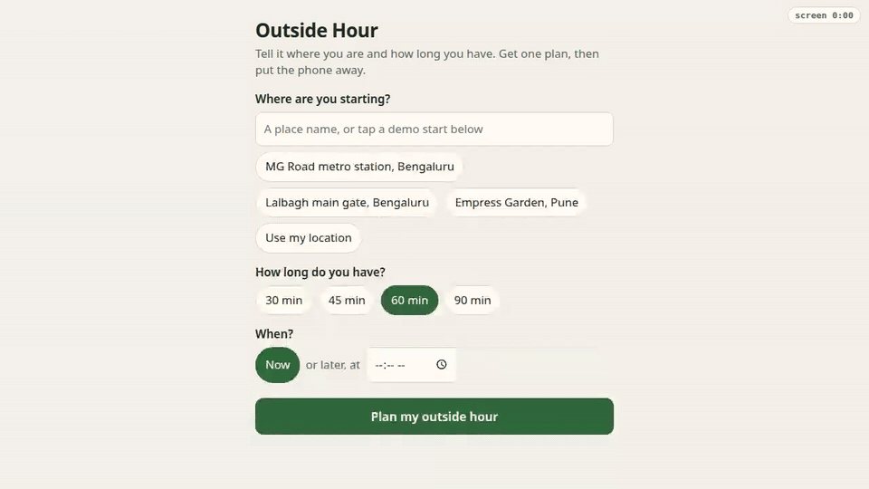

# Outside Hour

**Tell it where you are and how long you have. Get one real plan for going outside, then put the phone away.**

Outside Hour looks up real parks, lakes, gardens and viewpoints near you on OpenStreetMap, checks the weather,
sunset and air quality on Open-Meteo, and asks **Gemma 4 E2B, an open-weight model running on your own CPU**, to
pick one place and write a short pocket card: where to go, when to turn back, three small things to notice there,
and what to bring. Then it gets out of the way: a black "phone down" screen, a printable card, and a calendar
alarm for the turn-back time.

Built for the DEV × Hacktoberfest 2026 Open-Source AI Challenge, Week 1: "Touch Grass".



Demo: [`demo/outside-hour-demo.mp4`](demo/outside-hour-demo.mp4) (51 s, silent, captioned). It is a real run on my
laptop; the model wait is cut and labelled on screen. The uncut recording is
[`demo/outside-hour-demo-realtime.mp4`](demo/outside-hour-demo-realtime.mp4) (73 s).

## What it does

1. **You give:** a starting point (place name, your browser location, or a demo start), 30–90 minutes, now or later
   (for example "tomorrow 07:00").
2. **It fetches open data** (no API keys): named parks, gardens, water, viewpoints and paths within walking range
   (Overpass API), plus the hourly forecast, sunset and US AQI for exactly your time window (Open-Meteo).
3. **Code does the maths:** walking time (4.5 km/h × 1.3 detour factor), time at the place, turn-back time, a
   sunset cut-off, after-dark and thunder/AQI warnings, and the bring list. These are never left to the model.
4. **Gemma chooses and phrases:** it gets the 5 best candidates as JSON and returns one `place_id` plus a headline,
   a "why", three things to notice and a phone-down line.
5. **A checker guards the output** (`outside_hour/validate.py`). The draft is rejected if it names a place that is
   not in the fetched map data, talks up a different candidate, uses a number or clock time that is not in the
   facts, looks cut off, or contains stray non-English characters. One retry, then a plain template. The card
   always says who wrote it ("written by gemma-4-E2B-it-Q4_0 (local, llama.cpp)" or "plain template").
6. **You leave:** "Phone down" shows only the place, the turn-back time and how long you spent on the screen.
   "Print pocket card" prints a small card. "Turn-back alarm (.ics)" adds a calendar event with an alarm, so your
   phone's own clock reminds you and the app doesn't need to stay open.

## Why local and open

- **Free to run and no account:** OpenStreetMap and Open-Meteo need no keys; the model runs in llama.cpp on a laptop.
- **Your location stays with you:** the model sees your coordinates only on your machine. The only network calls
  are the open-data lookups, and they are cached.
- **Works with a bad signal:** once an area is cached, `--offline` plans with no network at all (weather may be
  stale; the card says so).
- **Open weights let me constrain it:** I can run Gemma with a JSON-schema grammar so `place_id` can *only* be one
  of the places I fetched, and turn off its "thinking" mode to make it fast enough on a CPU.

## Measured on my laptop

Intel Core i5-1035G1 (4 cores / 8 threads, no GPU), 10 GB RAM, WSL2. Model file: `gemma-4-E2B-it-Q4_0.gguf`,
2.84 GB. Numbers from `scripts/bench.py`: 10 different plans (3 cities, 30–90 min, morning to evening) on cached data (see `docs/bench-results.json`):

| Measure | Result |
|---|---|
| Plans written by Gemma (not the template) | 10 of 10 |
| Drafts rejected by the checker | 1 (it shortened the name to "The Botanical Gardens"; the retry passed) |
| Time per plan, median (min–max) | 24.8 s (12.8–43.7 s) |
| Prompt size / speed, median | 650 tokens at 55 tokens/s |
| Output size / speed, median | 131 tokens at 10.1 tokens/s |
| `llama-bench` pp512 / tg128, 4 threads | 61.9 / 9.4 tokens/s |
| `llama-bench` pp512 / tg128, 8 threads | 59.9 / 7.5 tokens/s (so the start script uses physical cores) |
| llama-server memory (RSS, 4096 context) | 4.7 GB |

The laptop was also running other work, so times vary from run to run. Before I switched off Gemma's
"thinking" (see `outside_hour/llm.py`), one call spent all 400 output tokens thinking: 47.5 s and no answer.

## Setup

Needs Linux/WSL or macOS, Python 3.10+, ~3 GB disk and ~5 GB free RAM. No GPU. No Python dependencies at runtime.

```bash
git clone https://github.com/xexpertai/outside-hour && cd outside-hour

# 1) Download llama.cpp (CPU build, b11555) and Gemma 4 E2B Q4_0 into this folder (≈2.9 GB, no sudo)
scripts/get-model.sh
# 2) Start the local model server on 127.0.0.1:8088 (leave it running)
scripts/start-model.sh

# 3a) Web app (one page, mobile-friendly): open http://127.0.0.1:8765
python3 -m outside_hour serve
# 3b) Or the command line
python3 -m outside_hour plan --near "Cubbon Park, Bengaluru" --minutes 60
python3 -m outside_hour plan --preset mg-road --minutes 45 --start 07:00
python3 -m outside_hour plan --preset mg-road --minutes 45 --offline   # cached data only
python3 -m outside_hour plan --preset mg-road --no-model               # template only, no model
```

On macOS, download the matching `llama-b11555-bin-macos-*.tar.gz` from the llama.cpp releases page instead (the
script fetches the Ubuntu x64 build). To try another open model, set `MODEL_REPO` and `MODEL_FILE` for both
scripts; anything llama.cpp can serve works, because the app talks to llama-server's HTTP API.

Tests (offline, recorded fixtures, no model needed):

```bash
uv venv .venv && uv pip install --python .venv/bin/python pytest
.venv/bin/python -m pytest -q
```

## How the code is laid out

| File | Job |
|---|---|
| `outside_hour/sources.py` | Overpass, Nominatim and Open-Meteo calls; User-Agent, spacing, retries, on-disk cache, offline mode |
| `outside_hour/places.py` | OSM elements → named candidate places; walking time, direction, size; ranking; skips cemeteries, drains, private land |
| `outside_hour/weather.py` | Forecast + AQI summary for your exact time window |
| `outside_hour/planner.py` | Deterministic facts → Gemma → checker → plan (or template) |
| `outside_hour/llm.py` | llama-server client: chat template, then JSON-schema-constrained completion |
| `outside_hour/validate.py` | The hallucination checker |
| `outside_hour/card.py` | Text pocket card and `.ics` turn-back alarm |
| `scripts/bench.py`, `scripts/record_demo.py`, `scripts/make-demo-media.sh` | Benchmark, demo recording (Playwright), MP4/GIF |
| `outside_hour/server.py`, `static/index.html` | The one-page web app (standard library only) |

## Limitations (honest list)

- Walking times are straight-line distance × 1.3, not real routing. Big parks are measured to the edge of their
  bounding box. The card says "about".
- It only knows what OpenStreetMap knows. Unnamed places are skipped; opening hours are passed through when tagged
  but not enforced.
- The 2B model's "things to notice" are pleasant but often generic (birds, bark, light). The checker stops
  invented places and numbers; it does not make the writing brilliant.
- A plan takes about 25 s on my CPU (median; 13–44 s in my benchmark). A GPU or a newer laptop is much faster.
- Weather is a forecast. Use your own judgement outside, especially after dark.

## Data, models and credits

- **Map data © OpenStreetMap contributors**, available under the
  [Open Database License (ODbL)](https://www.openstreetmap.org/copyright). Queried through the
  [Overpass API](https://overpass-api.de) and [Nominatim](https://nominatim.org), following their usage policies
  (descriptive User-Agent, at most one request per second, results cached, retries back off).
- **Weather and air quality: [Open-Meteo.com](https://open-meteo.com)**, data under CC BY 4.0.
- **Model: [Gemma 4 E2B-it](https://huggingface.co/google/gemma-4-E2B-it)** by Google DeepMind, Apache 2.0, using the
  [ggml-org GGUF conversion](https://huggingface.co/ggml-org/gemma-4-E2B-it-GGUF).
- **Inference: [llama.cpp](https://github.com/ggml-org/llama.cpp)** (MIT), prebuilt release b11555, used unchanged as
  a separate server.
- No code was copied from other projects. All code in this repository was written for this challenge, starting
  11 October 2026.

## AI assistance

I built this with help from an AI coding assistant (Claude), which drafted much of the code, tests and docs under
my direction. I reviewed, ran and tested it, and I'm responsible for it. The *product* uses no closed or paid AI:
only Gemma running locally.

Any commits made after the challenge deadline (12 Oct 2026, 12:29 IST) will be listed here.

## License

MIT, see [LICENSE](LICENSE).
